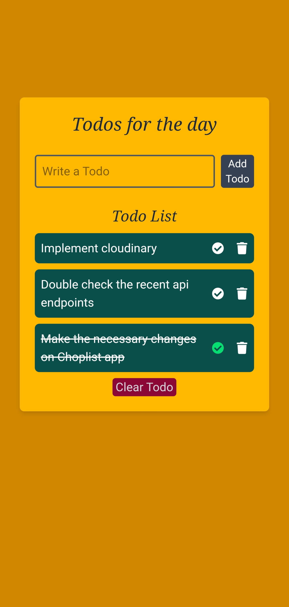

# My Todo App

A simple, responsive Todo application for organizing daily tasks. Built with React and TypeScript, with a distinctive amber and golden-yellow interface.

**[Live Demo](https://kenzok-todo.vercel.app/)** 

## Preview



## About the Project

My Todo App provides a simple way to keep track of daily responsibilities. Users can add tasks, mark them as completed, delete individual tasks, and clear the task list.

The goal was to build a straightforward task-management interface that makes everyday task organization easy.

## Features

- **Add tasks:** Enter a task and add it to your list.
- **Complete tasks:** Mark individual tasks as completed.
- **Delete tasks:** Remove individual tasks from the list.
- **Clear Todo:** Clear the task list.
- **Responsive interface:** Use the application on different screen sizes.

## Tech Stack

- React
- TypeScript
- Tailwind CSS
- Vite

## Getting Started

Follow these steps to run the project locally.

### Prerequisites

- Node.js
- npm
- Git

### Installation

1. Clone the repository:

   ```bash
   git clone https://github.com/kennetizokun/My-todo.git
   ```

2. Navigate into the project directory:

   ```bash
   cd My-todo
   ```

3. Install the dependencies:

   ```bash
   npm install
   ```

4. Start the development server:

   ```bash
   npm run dev
   ```

5. Open the local URL displayed in your terminal.

## What I Learned

Through this project, I practised building a React application with TypeScript, organizing UI components, handling user interactions, styling a responsive interface, and deploying a frontend application.

## Future Improvements

- Add task editing.
- Add task filtering for all, active, and completed tasks.
